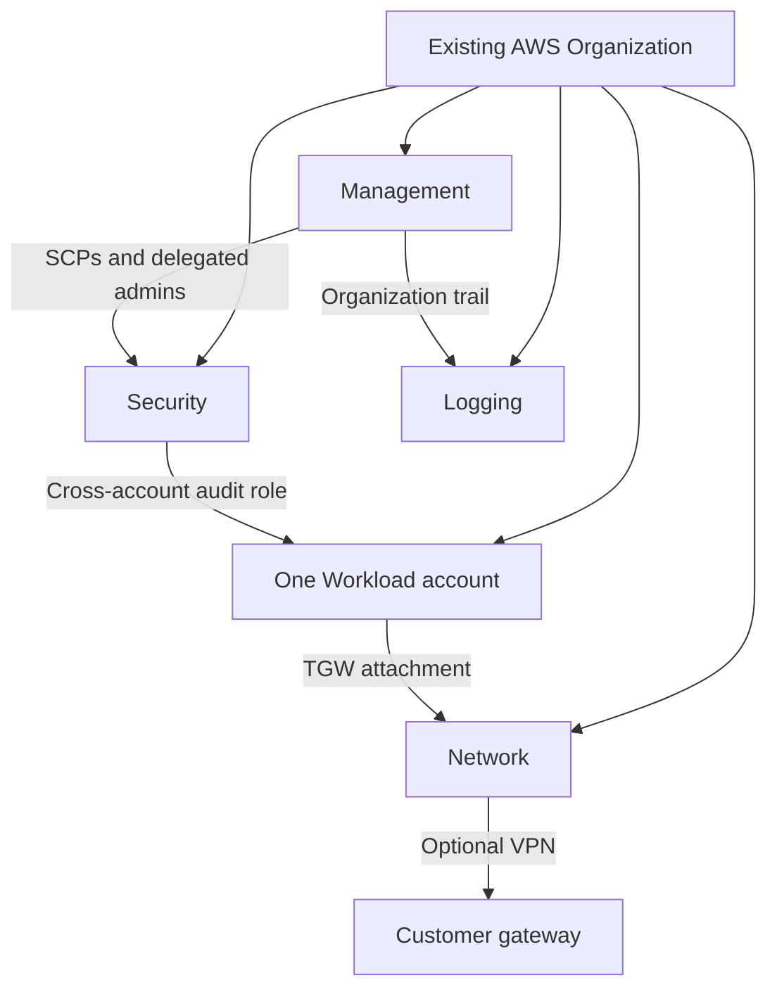

# Zero Trust AWS Multi-Account Lab


This portfolio project implements a **Terraform design for a five-account AWS security lab**: organization guardrails, a constrained cross-account audit role, a shared Transit Gateway, optional centralized egress/VPN, an organization CloudTrail, and optional delegated detection services.

> **Status (19 November 2026):** Terraform source and CI checks are present and being reviewed. No AWS deployment, successful plan/apply, screenshot, or end-to-end security test is evidenced here. Treat this as an implementation candidate, not a deployed or production-ready landing zone. Run the validation workflow and review a sandbox plan before any apply.

## What this repository implements

| Area | Terraform scope | Defaults and limits |
|---|---|---|
| AWS Organizations | Creates/manages org policy support, three OU containers, five SCPs, direct member-account and OU attachments | Requires a dedicated existing org; does not create or move accounts; SCPs do not restrict the management account |
| Account providers | Separate Management, Security, Logging, Network, and Workload aliases with account-ID guards | Uses local AWS CLI profiles; operator permission sets and MFA are configured outside Terraform |
| IAM | One Security-to-Workload read-only role chain and one attached permission boundary | Example roles only; does not enforce a boundary on every workload role |
| Networking | Network-account TGW, separate TGW route tables, one private Workload VPC, one Network VPC, RAM sharing, Flow Logs | NAT and Site-to-Site VPN are optional; NAT is single-AZ; one workload VPC only |
| Audit logging | Management-account multi-Region organization trail, Logging-account versioned SSE-S3 bucket and delete-deny policy | S3 data events are off unless explicit object ARNs are configured; no S3 Object Lock |
| Detection | Security-account GuardDuty and Security Hub organization configuration; EventBridge-to-SNS alerting | GuardDuty and Security Hub default off; email alerts require a configured address and subscription confirmation |
| AWS Config | Not implemented | No recorder, delivery channel, or aggregator is created |

The project creates resource code, not proof of runtime behavior. See [the implementation roadmap](docs/00-implementation-roadmap.md), [account prerequisites](docs/01-account-strategy.md), and [the evidence procedure](verification/README.md).

## Architecture



The Organization and five accounts must already exist and be dedicated to this lab. Terraform creates the OU containers but intentionally does not place accounts in them. Optional billable services are disabled by default. This is a learning/portfolio architecture, not a production landing zone: it has one workload VPC, a single-AZ NAT option, no AWS Config, no centralized Flow Log destination, and no application-specific security-group rules.

## Repository map

```text
.
├── ARCHITECTURE.md
├── docs/                         # Design, constraints, and implementation roadmap
├── diagrams/README.md            # Status of planned editable diagrams
├── policies/
│   ├── iam/                      # Annotated boundary and trust-chain examples
│   └── scps/                     # Annotated SCP JSON; Terraform strips root "_" metadata
├── terraform/
│   ├── main.tf                   # Root module wiring and provider aliases
│   ├── providers.tf              # Five account-specific AWS CLI profiles
│   ├── terraform.tfvars.example  # Safe placeholder configuration
│   └── modules/                  # Organizations, IAM, networking, security, logging
├── verification/                 # Commands, screenshot checklist, and test record template
└── .github/workflows/            # Terraform formatting and validation on pull requests
```

## Quick local structural checks

Use a dedicated AWS sandbox and the [detailed setup procedure](verification/README.md). First copy the example variables file, replace placeholders locally, configure the five AWS CLI profiles, and authenticate. From the repository root:

```bash
cp terraform/terraform.tfvars.example terraform/terraform.tfvars
cd terraform
terraform fmt -recursive
terraform init -backend=false
terraform validate
```

These commands do not deploy infrastructure. A plan requires valid AWS sessions and account IDs:

```bash
terraform plan -var-file=terraform.tfvars
```

**Do not run `terraform apply` until you have reviewed the entire plan, confirmed all five caller identities, and confirmed the target organization contains only dedicated sandbox accounts.** Import existing Organizations/OU resources first. Never commit `terraform.tfvars`, state, plan files, access keys, or unsanitized screenshots.

## Evidence status

- Design documents and Terraform source: present; subject to review and validation.
- GitHub Actions format/validate workflow: present; a passing run is required before claiming validation.
- AWS resources: not evidenced as deployed.
- Console screenshots and allow/deny tests: not recorded.
- Editable architecture diagram source/exports: not present yet.

Use the labels **designed**, **implemented**, and **validated** accurately. A policy file or a successful plan does not prove an AWS control works. For exact screenshots and safe tests, follow [verification/README.md](verification/README.md).

## Author

**Ilyas Benkhadra** — Cybersecurity Engineering, ENSA Oujda; AWS Certified Solutions Architect – Associate (SAA-C03); CCNA.

Portfolio: [github.com/ilyas-360](https://github.com/ilyas-360)
